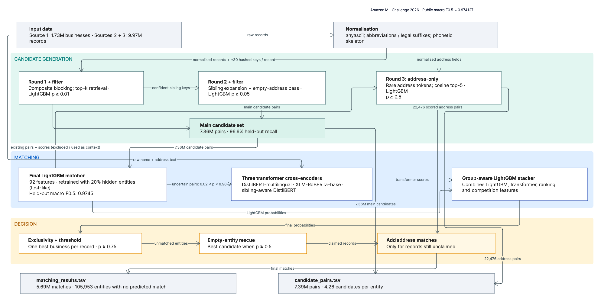

# Business Entity Resolution: Amazon ML Challenge 2026 (Team Muse)

**Team Muse:** Sruthi Sureshkumar (team leader) · Thaarini Balagapandian

This repository holds our pipeline for the Amazon ML Challenge 2026 business entity resolution task. The task is to
link each Source-1 business to the Source-2 and Source-3 records that describe the same business, across the US,
India and France, with noisy names, addresses and scripts. Our final submission scored a **public leaderboard macro
F0.5 of 0.974127**.

## How it works

1. **Candidate generation (blocking).**
   - **Round 1.** Composite hashed keys over phonetic and transliterated names and addresses, sparse top-k retrieval,
     a reverse-rank filter and a LightGBM filter.
   - **Round 2.** Sibling expansion and an empty-address pass.
   - **Round 3.** Address-only retrieval on rare address tokens.
2. **Matching.**
   - A 92-feature LightGBM matcher, retrained with 20 % of Source-1 entities hidden to mimic the test set.
   - Three multilingual cross-encoders rescore the uncertain pairs: DistilBERT-multilingual, XLM-RoBERTa-base and a
     sibling-aware DistilBERT.
   - A group-aware LightGBM stacker combines the scores.
3. **Decision.**
   - Each record goes to one entity only (exclusivity).
   - Threshold 0.75.
   - Empty-entity rescue at 0.5.
   - Address-only matches at 0.5, for records that are still unclaimed.

| result | value |
|---|---|
| public leaderboard macro F0.5 | **0.974127** |
| held-out macro F0.5 (stacker + rescue, test-like setting) | 0.9814 |
| held-out recall of the main candidate set | 96.6 % |

## Repository layout

| path | content |
|---|---|
| [`METHODOLOGY.md`](METHODOLOGY.md) | full methodology write-up, as submitted |
| [`REPRODUCE.md`](REPRODUCE.md) | exact commands to reproduce the pipeline end to end |
| [`requirements.txt`](requirements.txt) | pinned Python 3.11 environment |
| `src/` | all pipeline code |
| `src/notebooks/` | the Kaggle and Colab notebooks the pipeline ran on |
| `src/reports/` | held-out validation logs |
| `src/verification_kit/` | script that regenerates the submitted files exactly from saved contest-run intermediates |

## Notes

- **Data not included.** The challenge data, our output files and the verification kit's saved intermediates are
  not published here, because they come from the challenge dataset.
- **Reproducing the pipeline.** To rerun it, place the challenge data as described in `REPRODUCE.md`.
- **Model weights.** The two pretrained checkpoints (`distilbert-base-multilingual-cased`, Apache-2.0, and
  `xlm-roberta-base`, MIT) download from the Hugging Face hub.
- **No external data or services.** The pipeline uses no external business data, APIs or lookup services.
